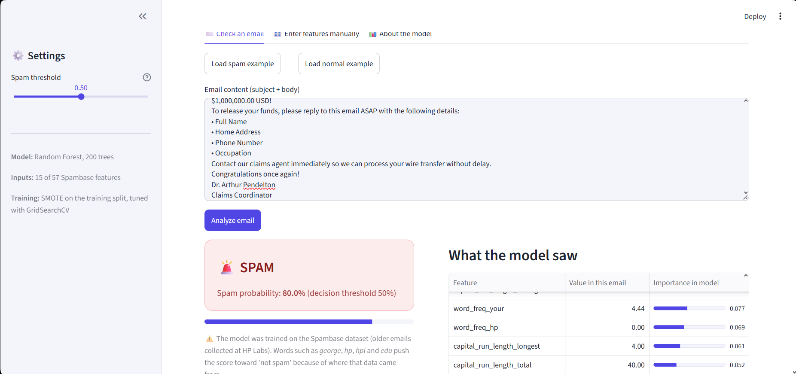
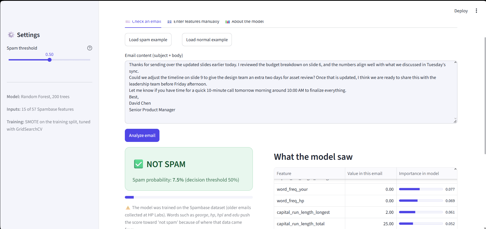
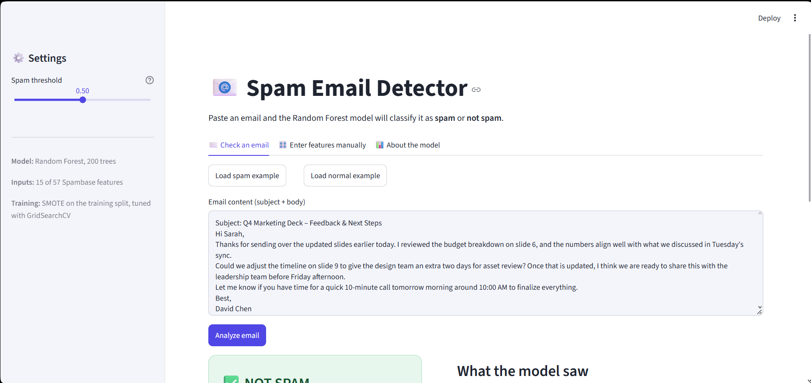
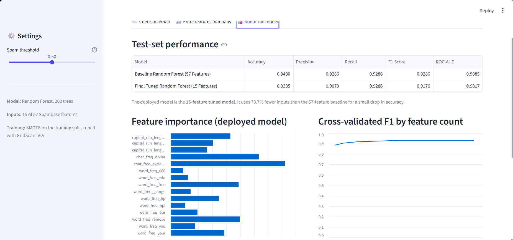

<p align="center">
  
</p>

<p align="center">
  
  
  
  
</p>

<p align="center">
  A Random Forest spam classifier with an interactive web interface, trained on the UCI Spambase dataset.
</p>

> **University:** Sri Lanka Instritute of Information Technology · **Module:** Artificial Intelligence & Machine Learning · **Semester:** Y2S1
> **Author:** Vishwa Nimantha Welivita

---

## Table of contents
- [Overview](#overview)
- [Features](#features)
- [Demo](#demo)
- [How it works](#how-it-works)
- [Model performance](#model-performance)
- [Project structure](#project-structure)
- [Setup](#setup)
- [Configuration](#configuration)
- [Retraining the model](#retraining-the-model)
- [Deployment](#deployment)
- [Troubleshooting](#troubleshooting)
- [Limitations](#limitations)
- [Dataset and citation](#dataset-and-citation)
- [License](#license)

## Overview
This project trains a Random Forest classifier to separate spam from legitimate email, then wraps it in a
Streamlit app. A user pastes an email, and the app converts the text into the numeric features the model
expects and returns a spam probability and verdict.

## Features
- **Paste-and-classify:** works on raw email text, with example emails to try.
- **Transparent results:** shows the 15 feature values behind each prediction and how important each feature is to the model.
- **Adjustable threshold:** a slider shows the precision vs. recall trade-off.
- **Manual mode:** enter the 15 feature values directly.
- **Model dashboard:** test metrics, feature importance and cross-validation results from the notebook.
- **Leakage-aware evaluation:** SMOTE is applied inside each cross-validation fold.

## Demo
<!-- Add your screenshots to docs/images/ and keep these names -->
| Spam detected | Normal email | Model tab |
|---|---|---|
|  | |  |  |

**Live app:** https://spam-email-detector-ghbrbphguogfjkfdsiode3.streamlit.app

## How it works
1. The user pastes an email into the app.
2. `feature_extractor.py` converts the text into the 15 Spambase features:
   - `word_freq_<word>` = 100 × occurrences of the word ÷ total words
   - `char_freq_<char>` = 100 × occurrences of the character ÷ total characters
   - `capital_run_length_*` = average, longest and total length of runs of capital letters
3. `model/random_forest_spam_final_model.pkl` returns the probability that the email is spam.
4. The app compares that probability with the threshold and shows the verdict.

**Training pipeline** (see the notebook): duplicate removal → stratified 80/20 split → SMOTE on the training
split only → baseline Random Forest on 57 features → feature ranking by importance → cross-validation for
57/30/20/15/10/7 features → GridSearchCV on the 15-feature set → evaluation on the untouched test set.

## Model performance
| Model | Accuracy | Precision | Recall | F1 | ROC-AUC |
|---|---|---|---|---|---|
| Baseline RF (57 features) | 0.9430 | 0.9286 | 0.9286 | 0.9286 | 0.9885 |
| **Final tuned RF (15 features)** | 0.9335 | 0.9070 | 0.9286 | 0.9176 | 0.9817 |

The deployed model uses 73.7% fewer features than the baseline for a small drop in accuracy.
Leakage-safe 5-fold CV F1 for the 15-feature model is about 0.918 (see `results/`).

## Project structure
```
spam-email-detector/
├── app.py                         # Streamlit user interface
├── feature_extractor.py           # raw email text -> model features
├── requirements.txt               # dependencies to run the app
├── requirements-notebook.txt      # extra dependencies to re-run the notebook
├── LICENSE
├── assets/
│   └── banner.svg                 # README banner
├── docs/images/                   # screenshots used in this README
├── .streamlit/config.toml         # UI theme and server settings
├── model/
│   ├── random_forest_spam_final_model.pkl      # deployed model (15 features)
│   ├── selected_features.pkl                   # feature names in model order
│   └── random_forest_baseline_57_features.pkl  # baseline, for comparison only
├── results/                       # CSV result tables exported from the notebook
└── notebooks/
    └── Random_Forest_Spam_Classification.ipynb
```

## Setup
**Requirements:** Python 3.10 or newer and Git.

```bash
git clone https://github.com/<your-username>/spam-email-detector.git
cd spam-email-detector

python -m venv .venv
source .venv/bin/activate          # Windows: .venv\Scripts\activate
pip install -r requirements.txt

streamlit run app.py
```
The app opens at <http://localhost:8501>.

## Configuration
| What | Where | Notes |
|---|---|---|
| Spam threshold | Sidebar slider in the app | Default 0.50. Lower catches more spam but flags more good email |
| Port | `streamlit run app.py --server.port 8080` | Default is 8501 |
| Theme colors | `.streamlit/config.toml` | Standard Streamlit theme options |
| Model and feature file paths | Constants at the top of `app.py` | Change them if you move the `model/` folder |
| scikit-learn version | `requirements.txt` | Pinned to **1.9.0**, the version the model was trained with |

## Retraining the model
1. Download `spambase.data` from the [UCI repository](https://archive.ics.uci.edu/dataset/94/spambase) and put it next to the notebook.
2. Install the notebook dependencies: `pip install -r requirements-notebook.txt`.
3. Run `notebooks/Random_Forest_Spam_Classification.ipynb` from top to bottom.
4. Copy the new `.pkl` files into `model/`. Keep the scikit-learn version in `requirements.txt` in sync with the one you trained with.

## Deployment
Use free on [Streamlit Community Cloud](https://spam-email-detector-ghbrbphguogfjkfdsiode3.streamlit.app):

## Troubleshooting
| Problem | Fix |
|---|---|
| `streamlit` is not recognized | Activate the virtual environment, or run `python -m streamlit run app.py` |
| `InconsistentVersionWarning` when loading the model | Install the pinned version: `pip install scikit-learn==1.9.0` |
| `No matching distribution found for scikit-learn==1.9.0` | Your Python is too old. Use Python 3.11 or newer |
| `ModuleNotFoundError: imblearn` in the notebook | `pip install -r requirements-notebook.txt` |
| Notebook fails with `spambase.data` not found | Download the dataset and place it next to the notebook |
| Port already in use | Run with a different port: `--server.port 8502` |
| Browser doesn't open | Open <http://localhost:8501> manually |

## Limitations
- Spambase stores numeric features, not raw text. The extractor recreates them, so results are close to, but not guaranteed identical to, the original extraction.
- The training emails are old and come from one source (HP Labs). Words such as `george`, `hp`, `hpl` and `edu` act as strong "not spam" signals, and modern spam may be missed.
- SMOTE creates synthetic samples that may not perfectly resemble real spam.
- This is a coursework demo, not a production spam filter.

## Dataset and citation
Hopkins, M., Reeber, E., Forman, G., & Suermondt, J. (1999). *Spambase Data Set*. UCI Machine Learning Repository.

## License
Released under the [MIT License](LICENSE).
